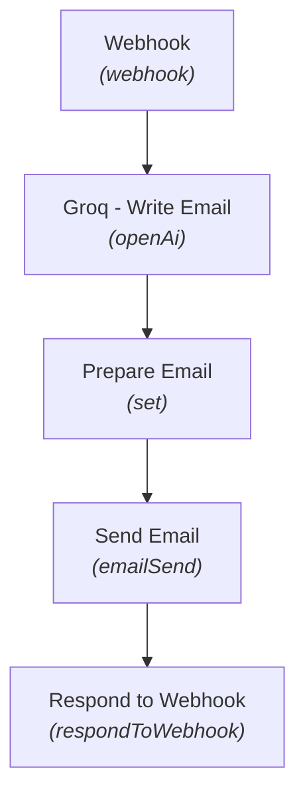

# ⚡ AI Cold Email Draft Generator & Launcher (Groq)

[](https://n8n.io)
[](#)
[](#)
[](#)

> **Workflow Sequence #10** in the [Maheen Azhar n8n Workflow Collection](https://github.com/maheenazhar/n8n-workflows-collection).


> 📊 **In-Depth Technical Report:** For detailed node configurations, runtime mechanics, security audits, and failure mode analysis, read the **[Comprehensive Technical & Operational Report](REPORT.md)**.

---

## 📖 Overview

Receives prospect profile data via Webhook, calls Groq LLM (high-speed LLaMA/Mixtral inference) to generate tailored cold outreach copy, formats the email payload, sends the email, and returns delivery confirmation.

### 🎯 Key Use Case
Automated hyper-personalized outbound sales development, partnership outreach, and recruitment email automation.

---

## 🏗️ Architecture & Flow



---

## 🧩 Nodes in this Workflow

| # | Node Name | Type | Version |
|---|-----------|------|---------|
| 1 | **Webhook** | `n8n-nodes-base.webhook` | v2 |
| 2 | **Groq - Write Email** | `@n8n/n8n-nodes-langchain.openAi` | v1.8 |
| 3 | **Prepare Email** | `n8n-nodes-base.set` | v3.4 |
| 4 | **Send Email** | `n8n-nodes-base.emailSend` | v2.1 |
| 5 | **Respond to Webhook** | `n8n-nodes-base.respondToWebhook` | v1.1 |

---

## 🔑 Prerequisites & Credentials

Before running this workflow, ensure you have the following configured in your n8n environment:

- [ ] **Groq API Key / OpenAI-compatible credentials**
- [ ] **SMTP / Email Send credential**
- [ ] **Webhook client or CRM webhook trigger**

> [!NOTE]
> All credentials are decoupled from this export file for security. When importing into your n8n workspace, re-assign your local credentials in the respective node configuration panels.

---

## 🚀 Setup & Installation

1. **Clone or Download:**
   ```bash
   git clone https://github.com/maheenazhar/n8n-10-cold-email-draft-launcher.git
   cd n8n-10-cold-email-draft-launcher
   ```
2. **Import into n8n:**
   - Open your n8n canvas.
   - Click the top-right menu `...` -> **Import from File**.
   - Select `workflow.json` from this repository.
   - *(Alternative)*: Open `workflow.json`, copy the entire JSON contents, and paste directly (`Ctrl+V`) onto the n8n canvas.
3. **Configure Credentials:**
   - Open each integration node marked with a red credential prompt.
   - Select or configure your accounts (e.g., Google OAuth, Groq API, Supabase, SMTP).
4. **Activate / Test:**
   - Click **Test step** or **Execute Workflow** to verify end-to-end functionality.
   - Toggle the workflow to **Active** for live production use.

---

## 📄 File Structure

```
10-cold-email-draft-launcher/
├── workflow.json   # Full exportable n8n workflow definition
├── README.md       # Comprehensive documentation and architecture
└── .gitignore      # Standard Git exclusions
```

---

## 👤 Author & Repository

- **Author:** [Maheen Azhar](https://github.com/maheenazhar)
- **Workflow ID:** `JHMiGrarOBMm7Rv7`
- **Created Date:** `2026-10-09 10:13:19.436`
- **Last Modified:** `2026-10-09 11:53:08.546`
- **Repository:** [`https://github.com/maheenazhar/n8n-10-cold-email-draft-launcher`](https://github.com/maheenazhar/n8n-10-cold-email-draft-launcher)

---

*Part of the [n8n Workflows Collection](https://github.com/maheenazhar/n8n-workflows-collection) by Maheen Azhar.*
